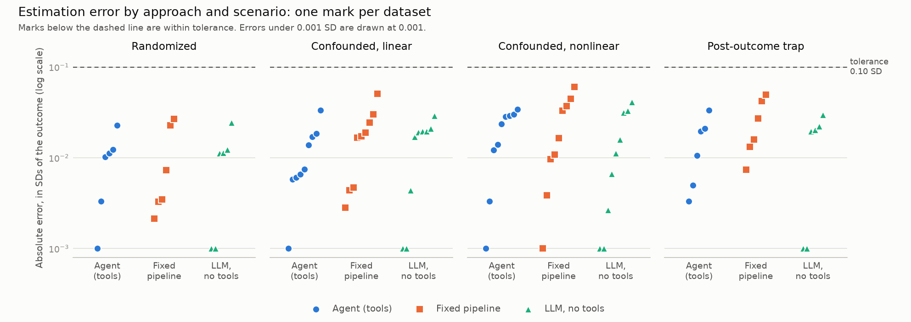
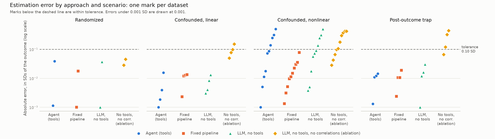

# causal-agent

A tool-using LLM agent that answers "what is the effect of X on Y?" on tabular
data. It chooses a causal method, runs it through three typed tools, and checks
its own answer. It is evaluated on synthetic datasets where the true effect is
known, against two baselines: the same LLM with no tools, and a fixed pipeline
with no LLM.

There are two benchmarks, each run once. **Benchmark v1** has 30 datasets;
its results are kept exactly as first published. **Benchmark v2** has 20
datasets designed after v1 failed to separate the approaches; its specs were
frozen before anything was run on it.

## Summary

**The agent did not beat either baseline on either benchmark.** On v1 all
three approaches were correct on every dataset. On v2 the fixed pipeline was
correct on all 20 datasets, and the agent and the no-tools LLM on 16 each. The
agent's four misses are the same four datasets the no-tools LLM missed.

Correct means within 0.10 standard deviations (SD) of the outcome of the true
effect.

| Approach | v1 correct | v2 correct | v2 mean abs. error (SD) | v2 estimator valid |
|---|---|---|---|---|
| Agent (tools) | 30/30 | 16/20 | 0.075 | 12/20 |
| Fixed pipeline (no LLM) | 30/30 | **20/20** | 0.016 | 20/20 |
| LLM, no tools | 30/30 | 16/20 | 0.079 | 12/20 (self-reported) |
| LLM, no tools, no correlations (ablation) | 18/30 | 10/20 | 0.173 | 12/20 (self-reported) |

- **Where the agent lost.** All four misses are v2 datasets where the same
  curved function of the confounders drives both treatment and outcome. The
  agent reported a linear regression on all 20 v2 datasets. On these four
  its errors were 0.14 to 0.50 SD.
- **It was warned.** On each of its four misses the agent ran the new
  estimator-disagreement check, which reported that linear regression and the
  doubly robust estimator disagreed. The agent kept the linear regression and
  called the doubly robust estimate an outlier. The doubly robust estimates it
  had already computed were within tolerance on all four.
- **The no-tools LLM's strength came from the correlation table.** Without
  it, the same model was correct on 18 of 30 v1 datasets and 10 of 20 v2
  datasets.
- **The three original refutation checks caught no inaccurate estimate** in
  any run. The new disagreement check flagged every inaccurate agent answer,
  with no false alarms on accurate agent answers. It also flagged four
  accurate fixed-pipeline answers, because it cannot say which of the two
  estimators is wrong.

The agent's toolset differs between the two runs: the disagreement check was
added after v1. The ablation is reported beside the original no-tools
baseline, not in place of it.

## Benchmark v1 results

**The agent did not beat either baseline.** All three approaches were within
tolerance on all 30 datasets, so the benchmark did not separate them on
accuracy. On method validity the agent was behind the fixed pipeline.

Every number here comes from one real run of
`python -m causal_agent.eval.run --refute` (model `claude-haiku-5-5`). The
full report is in [docs/results/results.md](docs/results/results.md) and the
per-dataset scores are in [docs/results/scores.csv](docs/results/scores.csv).

### Accuracy

An estimate is correct when it is within 0.10 standard deviations (SD) of the
outcome of the true effect.

| Approach | Within 0.05 SD | Within 0.10 SD | Within 0.20 SD | Mean abs. error (SD) | Median abs. error (SD) |
|---|---|---|---|---|---|
| Agent (tools) | 30/30 | 30/30 | 30/30 | 0.015 | 0.012 |
| Fixed pipeline | 28/30 | 30/30 | 30/30 | 0.020 | 0.016 |
| LLM, no tools | 30/30 | 30/30 | 30/30 | 0.014 | 0.014 |

Every approach was correct on every dataset in every scenario (6/6, 9/9, 9/9
and 6/6). The largest error by any approach was 0.06 SD.



### Method validity

Validity is whether a method's assumptions hold for the dataset, judged
against the true causal graph. It is scored separately from accuracy.

| Approach | Adjustment set valid | Estimator valid | Invalid but accurate |
|---|---|---|---|
| Agent (tools) | 30/30 | 24/30 | 6 |
| Fixed pipeline | 30/30 | 30/30 | 0 |
| LLM, no tools (self-reported) | 30/30 | 24/30 | 6 |

The agent reported a linear regression on all 30 datasets. On the 6 datasets
with a nonlinear outcome, a linear outcome model is misspecified, so those 6
answers count as invalid even though they were accurate. For the fixed
pipeline's doubly robust estimator, "valid" means a valid adjustment set and
adequate overlap; whether its boosted models fit well enough cannot be read
from the ground truth.

### Refutation

The evaluation ran every applicable refutation check on each approach's final
method. An estimate is flagged when at least one check fails.

| Approach | Estimates checked | Inaccurate estimates flagged | Accurate estimates flagged |
|---|---|---|---|
| Agent (tools) | 30 | 0 of 0 | 0 of 30 |
| Fixed pipeline | 30 | 0 of 0 | 2 of 30 |
| LLM, no tools | 30 | 0 of 0 | 0 of 30 |

Because no final estimate was inaccurate, this run cannot show whether
refutation catches bad estimates. It does show two false alarms: the
data-subset check failed on two accurate fixed-pipeline estimates (`ds_001`
and `ds_027`). The doubly robust estimator refits its models on each subset,
so it moves more between subsets than a regression does.

The agent ran a refutation check on its own final method in 10 of 30
questions; all 10 passed.

A separate check during development, not part of the committed evaluation,
ran the placebo and data-subset checks on estimates that are biased by
construction. They flagged 0 of 23 inaccurate unadjusted estimates and 0 of 4
inaccurate regressions that adjusted for the trap column. These checks detect
instability, not bias.

### Ablation: the no-tools baseline without the correlation table

This was run after the v1 results above, as a separate run. It adds a fourth
approach and changes nothing above. The ablation is the no-tools baseline with
the correlation table removed from its summary; the column statistics, the
means by treatment group and the timing labels stay. The full report is in
[docs/results/v1-ablation/results.md](docs/results/v1-ablation/results.md).

| Approach | Within 0.05 SD | Within 0.10 SD | Within 0.20 SD | Mean abs. error (SD) | Median abs. error (SD) |
|---|---|---|---|---|---|
| LLM, no tools (original, from above) | 30/30 | 30/30 | 30/30 | 0.014 | 0.014 |
| LLM, no tools, no correlations (ablation) | 13/30 | 18/30 | 23/30 | 0.124 | 0.079 |

| Scenario | LLM, no tools (original) | No correlations (ablation) |
|---|---|---|
| Randomized | 6/6 | 6/6 |
| Confounded, linear | 9/9 | 4/9 |
| Confounded, nonlinear | 9/9 | 6/9 |
| Post-outcome trap | 6/6 | 2/6 |

Without the correlation table the no-tools model was correct on 18 of 30
datasets. It stayed correct on all 6 randomized datasets, where the raw gap
between the groups is the answer, and lost accuracy wherever adjustment is
needed. So on v1 the no-tools baseline matched the agent because the summary
handed it the inputs of a regression, not because tools are unnecessary. With
that table removed, the agent (30/30) and the fixed pipeline (30/30) are both
ahead of the no-tools model on v1.

The ablation named a valid adjustment set on all 30 datasets and still missed
12, so its misses are not explained by which columns it said it adjusted for.
Its method is self-reported: it has no way to run one. The evaluation's
refutation checks flagged none of
those 12. For a no-tools answer the checks re-run the method the model named,
not the number it guessed, so this is weak evidence about the checks.

## Failure analysis (Benchmark v1)

There were no accuracy failures to analyse in the original v1 run, so this
section explains why the benchmark did not separate the approaches and where
the agent's method choice fell short. It was written before the ablation
above and is kept as written.

**The agent's tools added no measurable accuracy over the summary.** The
no-tools model received column statistics, group means and the correlation
matrix. From those it worked out a linear regression by hand on every dataset
and was as accurate as the agent. Its method is self-reported, but its written
working shows the calculation.

**Round true effects helped the no-tools model.** The true effects are 0, 0.5,
1, 2 and −1. The no-tools model rounds its hand calculation (for example 1.99
to 2.0), and 8 of its 30 answers equal the true effect exactly. The agent had
2 exact answers and the fixed pipeline none.

**The agent chose the more precise estimator, not the more robust one.** It
ran both linear regression and the doubly robust estimator on all 30 datasets
and reported the linear regression every time. Its stated reasons were that
the two estimates agreed and that the regression was more precise (27 of 30
answers cite precision or the standard error). That cost it validity on the 6
nonlinear-outcome datasets and cost it nothing in accuracy. None of the three
tools reports a diagnostic for a misspecified outcome model, so the agent had
no direct evidence to prefer the robust estimator; in at least one answer it
asserted that the outcome "looks roughly linear" without a tool result to
support it.

**The nonlinear scenario does not punish linear regression.** A separate check
during development ran linear regression with all pre-treatment covariates on
the 9 nonlinear datasets, and it was within tolerance on all 9. The scenario
breaks the estimator's assumption without producing enough bias to matter at
this tolerance.

**The trap was avoided by everyone.** No approach adjusted for the
post-outcome column on any of the 6 trap datasets. The timing label makes the
column easy to spot: the fixed pipeline excludes it by rule, and both LLM
approaches cited the label.

**Adjusting for everything measured before treatment is always right here.**
The agent's final adjustment set equalled all pre-treatment columns on 22 of
30 datasets and was a valid subset on the other 8. With no hidden confounders
and no pre-treatment colliders, there is no dataset where choosing the
adjustment set is hard.

**How the agent used its tools.** It needed 2 or 3 model calls per question
(23 questions took 3), well under the cap of 8, and made 125 tool calls with
no errors: `estimate_effect` on all 30 questions, `discover_graph` on 25 and
`refute_estimate` on 10. Every final answer matched a logged
`estimate_effect` call.

## Benchmark v2 results

### What v2 changes

Benchmark v2 exists because v1 could not rank the approaches. A linear
regression is biased only when the same curve drives both who is treated and
the outcome, and v1's two curves are nearly unrelated. In v2 the treatment and
the outcome share one curved function of the confounders. Everything else is
as in v1: every confounder is observed, the treatment effect is constant, and
the public columns and timing labels are the same.

- 20 datasets, `ds_101` to `ds_120`: 2 randomized, 4 confounded linear, 10
  confounded nonlinear (2 with a curved outcome only, 2 with a curved
  treatment model only, 6 with both), 4 with the post-outcome trap.
- True effects are non-round values drawn by a seeded generator; two datasets
  (both trap datasets) have an effect of exactly zero.
- The specs, their validation tests and the decision record were committed
  before any approach was run on v2 and were not changed afterwards.
- For each dataset the record lists how far a linear regression would land
  from the truth with unlimited data. It is 0.100 to 0.502 SD on the six
  "both sides" datasets and at most 0.003 SD on the other fourteen. That
  number was recorded, not used to choose datasets.

The full specification is in
[docs/decisions/004-benchmark-v2.md](docs/decisions/004-benchmark-v2.md).

### The run

One run of
`python -m causal_agent.eval.run --benchmark v2 --refute --approaches fixed_pipeline agent no_tools no_tools_no_correlations`.
The full report is in [docs/results/v2/results.md](docs/results/v2/results.md),
the per-dataset scores in [docs/results/v2/scores.csv](docs/results/v2/scores.csv)
and the run record in
[docs/results/v2/run_record.json](docs/results/v2/run_record.json).

| Item | Value |
|---|---|
| Model | `claude-haiku-5-5` (requested, and reported by the API in every response) |
| Effort, output cap, step cap | `medium`, 8,000 tokens per response, 8 model calls per agent question |
| Dataset spec digest | `e06a2ef6e3c56eca661f692b87960ee2c11768d3cfef4690d1c47f6eb5606867` |
| Code commit | `9a6d836` (clean working tree) |
| Model calls | 98 new, none from cache: agent 58, no-tools 20, ablation 20 |
| Agent tool calls | 89 (`estimate_effect` 56, `refute_estimate` 20, `discover_graph` 13), 0 errors |
| Unanswered questions | 0 of 80 |

A first attempt was stopped by Claude Code because the machine ran low on
memory. It had answered two datasets with the fixed pipeline and made no model
call. The run above started again from the beginning.

### Accuracy

| Approach | Within 0.05 SD | Within 0.10 SD | Within 0.20 SD | Mean abs. error (SD) | Median abs. error (SD) |
|---|---|---|---|---|---|
| Agent (tools) | 14/20 | 16/20 | 17/20 | 0.075 | 0.013 |
| Fixed pipeline | 19/20 | 20/20 | 20/20 | 0.016 | 0.012 |
| LLM, no tools | 13/20 | 16/20 | 17/20 | 0.079 | 0.017 |
| LLM, no tools, no correlations (ablation) | 5/20 | 10/20 | 14/20 | 0.173 | 0.103 |

| Design (within 0.10 SD) | Datasets | Agent | Fixed pipeline | LLM, no tools | Ablation |
|---|---|---|---|---|---|
| Randomized | 2 | 2/2 | 2/2 | 2/2 | 2/2 |
| Confounded, linear | 4 | 4/4 | 4/4 | 4/4 | 3/4 |
| Nonlinear outcome only | 2 | 2/2 | 2/2 | 2/2 | 0/2 |
| Nonlinear treatment only | 2 | 2/2 | 2/2 | 2/2 | 1/2 |
| Nonlinear on both sides | 6 | 2/6 | 6/6 | 2/6 | 3/6 |
| Post-outcome trap | 4 | 4/4 | 4/4 | 4/4 | 1/4 |



### Comparison with the baselines

- **Against the fixed pipeline, the agent lost.** The pipeline adjusts for
  every pre-treatment column with the doubly robust estimator and was within
  0.08 SD on every dataset. The agent's four misses are four of the six
  "nonlinear on both sides" datasets. Its two hits there (`ds_117`, `ds_119`)
  are the datasets with the smallest recorded linear-regression bias (0.100
  and 0.131 SD), where sampling noise put the estimate inside the tolerance.
- **Against the no-tools LLM, the agent tied.** Both scored 16/20 and missed
  the same four datasets. On 17 of 20 datasets their estimates were within
  0.011 of each other: both effectively ran a linear regression on all
  pre-treatment columns, the agent through the tool and the no-tools model by
  hand from the correlation table.
- **Method validity.** Every approach chose a valid adjustment set on all 20
  datasets; no approach adjusted for the post-outcome column. The agent
  reported linear regression on all 20, which is misspecified on the 8
  datasets with a curved outcome: 4 of those answers were accurate anyway,
  and 4 were not. The fixed pipeline's method was valid on all 20, as far as
  the ground truth can show.

### Ablation on v2

Without the correlation table the no-tools model was correct on 10 of 20 v2
datasets, against 16 with it. As on v1, it stayed correct on the randomized
datasets and lost accuracy wherever adjustment is needed; it missed 3 of the 4
trap datasets while naming a valid adjustment set on each. Its estimates were
never within 0.011 of the agent's.

### Failure analysis (Benchmark v2)

**The agent's misses come from its choice of estimator, not of columns.** On
every dataset it ran both linear regression and the doubly robust estimator
and reported the linear regression. On the four datasets it missed:

| Dataset | True effect | Agent (linear regression) | Doubly robust, computed by the agent | Disagreement check run by the agent |
|---|---|---|---|---|
| `ds_104` | 0.27 | 1.49 | 0.46 | disagreement, 0.44 SD |
| `ds_107` | −1.97 | −1.34 | −1.88 | disagreement, 0.21 SD |
| `ds_109` | −0.55 | −0.34 | −0.57 | disagreement, 0.15 SD |
| `ds_111` | −1.03 | −0.11 | −1.015 | disagreement, 0.31 SD |

**The agent read the warning and overrode it.** In each answer it said that
at least one of the two estimators was wrong, then chose linear regression.
It gave three kinds of reason:

- The doubly robust estimate was "the outlier" and its boosted models were
  probably fitting poorly.
- Linear regression agreed with propensity weighting. Both are linear models
  of the same columns, so their agreement is not independent evidence.
- On `ds_111`, the direction of the raw gap made a large negative effect seem
  implausible.

None of the tools could tell it which estimator was right, and its prior
favoured the simpler model. The check worked; the decision rule the model
applied to it did not.

**The check ran on 12 of 20 questions.** The agent called the disagreement
check on 12 questions: 4 disagreements, 7 agreements and 1 inconclusive. It
did not call it on the other 8, none of which it missed.

**One answer was not backed by a logged estimate.** On `ds_116` the agent
reported 0.114 with the adjustment set {x2, x3, x4}. The 0.114 came from a
regression on all four covariates; the set it named was only run inside a
refutation call. The answer was accurate and the set it named is valid.

**Agent behaviour.** 2 to 4 model calls per question (mean 2.9, cap 8), 89 tool
calls, no tool errors, and the original refutation checks on its own final
method in 6 of 20 questions (all passed).

## Refutation failure analysis

Refutation is counted against accuracy: a flag on an inaccurate estimate is a
detected problem, a flag on an accurate one is a false alarm.

### The three original checks

| Run | Approach | Inaccurate estimates flagged | Accurate estimates flagged |
|---|---|---|---|
| v1 | Agent / Fixed pipeline / LLM, no tools | none inaccurate | 0/30, 2/30, 0/30 |
| v1 ablation | LLM, no tools, no correlations | 0/12 | 0/18 |
| v2 | Agent | 0/4 | 0/16 |
| v2 | Fixed pipeline | none inaccurate | 2/20 |
| v2 | LLM, no tools | 0/4 | 0/16 |
| v2 | LLM, no tools, no correlations | 0/10 | 0/10 |

The checks never caught an inaccurate estimate, in any run. A development
check on v1 data, outside the committed evaluation, also flagged 0 of 23
unadjusted estimates and 0 of 4 regressions that adjusted for the trap column,
all biased by construction.

They cannot catch these estimates because each check keeps the adjustment set
and the model fixed and re-runs the same estimator:

- A placebo (shuffled) treatment is unrelated to everything, so any estimator
  returns about zero whether or not the original was biased.
- An added column of pure noise cannot move an estimate.
- Every 80% subset carries the same bias, so the estimate barely moves.

They detect estimators that find effects in noise, and unstable estimates.
Their only flags were four false alarms on accurate doubly robust estimates
(v1 `ds_001`, `ds_027`; v2 `ds_104`, `ds_112`). That estimator refits
flexible models on every re-run, so it moves more than a regression.

### The estimator-disagreement check (v2 only)

The check compares an estimate with one from the other model family on the
same adjustment set: the doubly robust estimator against linear regression.
The uncertainty of the difference comes from each estimator's per-row
contributions, so the correlation between two estimates on the same rows is
accounted for. The verdict is `disagreement` when the whole interval
(difference ± 2 paired standard errors) lies outside ±0.10 outcome SDs,
`agreement` when it lies inside, and `inconclusive` otherwise. See
[docs/decisions/005-estimator-disagreement-check.md](docs/decisions/005-estimator-disagreement-check.md).

| Approach | Detected (inaccurate, disagreement) | False alarm (accurate, disagreement) | Missed (inaccurate, agreement) | Accurate, agreement | Inconclusive |
|---|---|---|---|---|---|
| Agent | 4/4 | 0/16 | 0/4 | 15/16 | 1 (accurate) |
| Fixed pipeline | none inaccurate | 4/20 | none inaccurate | 15/20 | 1 (accurate) |
| LLM, no tools | 4/4 | 0/16 | 0/4 | 15/16 | 1 (accurate) |
| LLM, no tools, no correlations | 3/10 | 1/10 | 7/10 | 7/10 | 2 (accurate) |

- **It found the misspecified models.** Every inaccurate linear regression
  from the agent and the no-tools LLM was flagged, and no accurate one was.
- **It does not say which estimator is wrong.** The fixed pipeline's four
  "false alarms" are on four "nonlinear on both sides" datasets. There the
  pipeline's doubly robust estimate was accurate and the comparison, linear
  regression, was the biased one. Disagreement is not proof that the
  reported estimate is biased, and this is why.
- **It checks a method, not a number.** For the no-tools models the check
  runs the method the model named. The ablation's misses are mostly
  arithmetic errors made with a correctly named method, so the check found
  only 3 of its 10.
- **Inconclusive cases.** `ds_119` was inconclusive for all four approaches.
  The difference between the two estimators (about 0.09 SD) sat at the bound.
  The ablation's answer on `ds_120` named difference in means, which has no
  adjustment set to compare.
- **It cannot see a wrong adjustment set.** Both estimators share it. No v2
  answer used an invalid set, so this run does not test that limitation.

## Limitations

- **Small benchmark, one run each.** 30 and 20 datasets, one seed per
  dataset, one model response per question. Most of v2's difficulty sits on
  six datasets, so a difference of one or two datasets between approaches is
  weak evidence.
- **v1 is too easy to rank the approaches.** All three scored
  30/30. The results show that the pipeline, tools and agent work end to end;
  they do not show that an agent is better than a fixed rule.
- **v2 targets one failure.** It was built around the case that breaks
  linear adjustment, after v1 had been run. The family was chosen knowing it
  challenges a linear model, which helps the fixed pipeline's flexible
  estimator by design. The specs were frozen before any approach ran on them
  and were not tuned on results.
- **The disagreement check is exploratory.** Its bound (0.10 SD, the same as
  the scoring tolerance) and its 2-standard-error interval were fixed before
  the v2 run and not calibrated. Its paired standard error treats the fitted
  models as fixed, so it understates uncertainty, most when overlap is weak.
  It was measured on one run of 20 datasets.
- **The agent's toolset differs between v1 and v2.** The v1 agent had no
  disagreement check.
- **No hidden confounding.** Every confounder is observed, so the hardest
  problem in real causal inference is absent.
- **Constant treatment effect.** The average effect and the effect on the
  treated coincide, so the benchmark cannot detect confusion between them.
- **Synthetic data only.** Independent Gaussian covariates, a clean binary
  treatment and no missing values. Nothing here says how the approaches would
  do on real data.
- **The original refuters detect instability, not bias.** They cannot detect
  a wrong adjustment set or a misspecified model.
- **The trap is easy.** The post-outcome column is marked by a timing label,
  and every approach avoided it in both benchmarks.
- **Validity for the doubly robust estimator is weaker** than for the others,
  because the fit of its models cannot be checked against the ground truth.
- **The fixed pipeline's rule is specific to this benchmark.** Adjusting for
  every pre-treatment column is not safe in general.
- **One model.** Only `claude-haiku-5-5` was run, at one effort setting.

## How it works

```
                  public CSV + column timing labels
                                  │
        ┌─────────────────────────┼──────────────────────────┐
        ▼                         ▼                          ▼
  Fixed pipeline            Agent loop                 LLM, no tools
  (no LLM): all             (raw Anthropic SDK,        (same model, same
  pre-treatment             ≤ 8 model calls)           summary, no tools)
  columns + doubly          summary + 3 tools:
  robust estimator          discover_graph
        │                   estimate_effect
        │                   refute_estimate
        │                         │                          │
        └─────────────── final answer: estimate, estimator, adjustment set
                                  │
                                  ▼
            evaluation: reads ground truth only now; scores accuracy
            and validity; runs the refutation and disagreement checks
            on the final method; writes report, CSV, plot, run record
```

Model responses are cached on disk, keyed by the full request, and every tool
call is logged per question. Agent and tool code cannot import the ground
truth; a test scans their imports.

### The benchmarks

Each dataset has a binary treatment `t`, a continuous outcome `y` and four
covariates `x1..x4`, with 5,000 rows. The true average treatment effect (ATE)
is a number written into the outcome equation, so it is known exactly.

| Scenario | v1 | v2 | What is hard about it |
|---|---|---|---|
| Randomized | 6 | 2 | Nothing: treatment is independent of the covariates |
| Confounded, linear | 9 | 4 | Two covariates drive both treatment and outcome |
| Confounded, nonlinear | 9 | 10 | The same, with a nonlinear treatment model, outcome model, or both; in v2 one curve is shared by both |
| Post-outcome trap | 6 | 4 | One column is caused by both treatment and outcome and must not be adjusted for |

Confounding strength, outcome noise and nonlinearity are independent knobs.
Column names are neutral and shuffled, dataset IDs do not encode the scenario,
and every dataset has the same public schema. The only hint about the trap
column is a timing label (`post_outcome`), as a data dictionary would give.

A **confounder** is a variable that influences both who gets treated and the
outcome. It makes the raw gap between treated and untreated units differ from
the true effect. Adjusting for it removes that distortion; adjusting for a
variable that is itself caused by the treatment or outcome adds a new one.

### The three tools

| Tool | What it does | What it cannot do |
|---|---|---|
| `discover_graph` | Runs the PC algorithm and reports which columns stay associated after conditioning on others | Prove causation or direction; directions come from timing labels |
| `estimate_effect` | Estimates the ATE with a chosen estimator and adjustment set | Judge whether the adjustment set is appropriate |
| `refute_estimate` | Re-runs an estimate under a placebo treatment, an added noise covariate, or random subsets. Since v2, it can also compare the estimate with one from the other model family (estimator disagreement) | The original checks: detect a wrong adjustment set or a misspecified model. The disagreement check: detect a wrong adjustment set, or say which estimator is wrong |

Estimators: difference in means, linear regression, propensity weighting, and
a cross-fitted doubly robust estimator with gradient-boosted models. There is
no tool that runs arbitrary code, and the model cannot choose which dataset a
tool reads.

### The approaches

- **Agent.** One loop on the raw Anthropic SDK (`claude-haiku-5-5`), at most 8
  model calls per question. It sees a text summary of the data and can call
  the three tools.
- **LLM, no tools.** The same model and the same summary, and nothing else.
  The summary has column statistics, means by treatment group and the
  correlation matrix.
- **Fixed pipeline.** No LLM. It adjusts for every column labelled
  `pre_treatment` and uses the doubly robust estimator.
- **Ablation: LLM, no tools, no correlations.** The no-tools baseline with
  the correlation matrix removed from its summary. Reported separately.

All of them read only the public data. Ground truth is loaded by the
evaluation after an approach has answered.

### Scoring

An estimate is **correct** when it is within 0.10 standard deviations of the
outcome of the true ATE. Results are also shown at 0.05 and 0.20.

**Validity** is scored separately from accuracy. A method is valid when its
adjustment set passes the backdoor criterion on the true graph, overlap is
adequate, and the estimator's own assumption is not known to fail. A valid
method can be inaccurate, and an invalid one can land close by luck.

## Reproduce

Requires [uv](https://docs.astral.sh/uv/). Commands are for PowerShell.

```powershell
uv sync
uv run ruff check .
uv run pytest
```

To run the evaluation, put an Anthropic API key in `.env`:

```
AGENT_LLM_KEY=your-key
```

```powershell
# Benchmark v1, all three approaches, also refuting each final method
uv run python -m causal_agent.eval.run --refute --report-dir results\rerun-v1

# The no-tools ablation on v1, beside the original no-tools baseline
uv run python -m causal_agent.eval.run --refute --approaches no_tools no_tools_no_correlations --report-dir results\rerun-v1-ablation

# Benchmark v2, all four approaches
uv run python -m causal_agent.eval.run --benchmark v2 --refute --approaches fixed_pipeline agent no_tools no_tools_no_correlations --report-dir results\rerun-v2
```

The datasets are regenerated from seeds on every run (`data/benchmark/` and
`data/benchmark_v2/`, both gitignored). Tests check that every v1 and v2
dataset still matches the fingerprints recorded when it was frozen.

Rerunning v1 with the current code sends the agent different requests from
the original run, because the `refute_estimate` tool definition changed when
the disagreement check was added. To rerun v1 with the agent's original
toolset, check out commit `67ee865`. Cached responses replay only on the
machine that made them; elsewhere a rerun makes new model calls, and the
model's answers may differ.

A run stops before doing anything if its report directory already holds a
report, so the published results in `docs/results/` cannot be replaced by
accident. Pass `--report-dir` to write somewhere else, or `--overwrite` to
replace a report on purpose.

Model responses are cached under `results/cache/`, so a second run on the same
machine makes no API calls and gives the same answers. Each question's tool
calls are logged under `results/runs/`.

## Repository layout

```
src/causal_agent/
  bench/    synthetic datasets: specs, structural equations, true graphs,
            public metadata, private ground truth
  tools/    discover_graph, estimate_effect, refute_estimate, and the estimators
  agent/    the agent loop, the no-tools baseline, the fixed pipeline
  eval/     scoring, the report, the run script
  config.py settings: model, step cap, tolerance, paths
tests/      one test module per source module
docs/
  decisions/  decision records
  results/    Benchmark v1: results table, per-dataset scores, plot
    v1-ablation/  the no-tools ablation on Benchmark v1
    v2/           Benchmark v2: results, scores, plot, run record
  PROGRESS.md
```

## Decision records

- [001: Synthetic dataset generator](docs/decisions/001-synthetic-generator.md)
- [002: Estimators, fixed-pipeline baseline, and the three tools](docs/decisions/002-estimators-baseline-tools.md)
- [003: Evaluation protocol](docs/decisions/003-evaluation-protocol.md)
- [004: Benchmark v2](docs/decisions/004-benchmark-v2.md)
- [005: Estimator-disagreement check](docs/decisions/005-estimator-disagreement-check.md)
